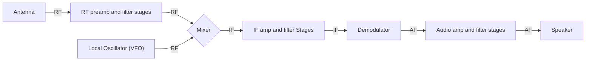
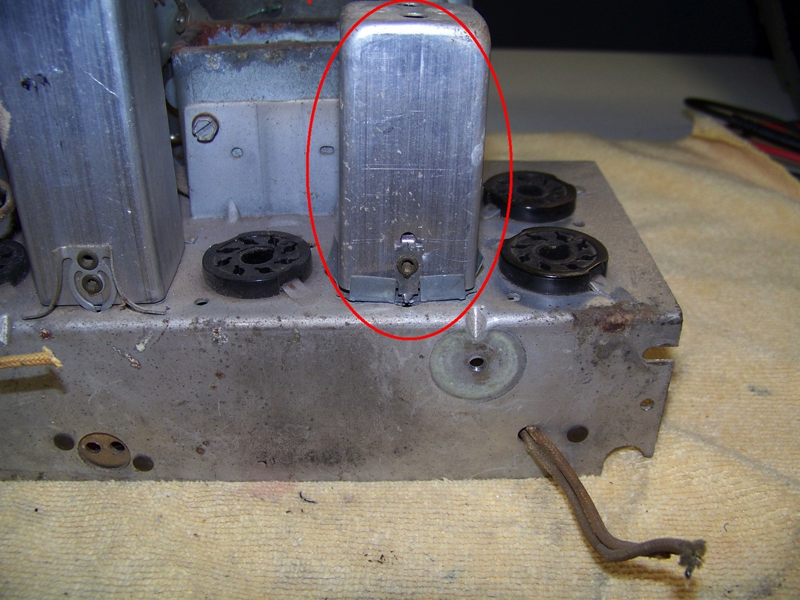
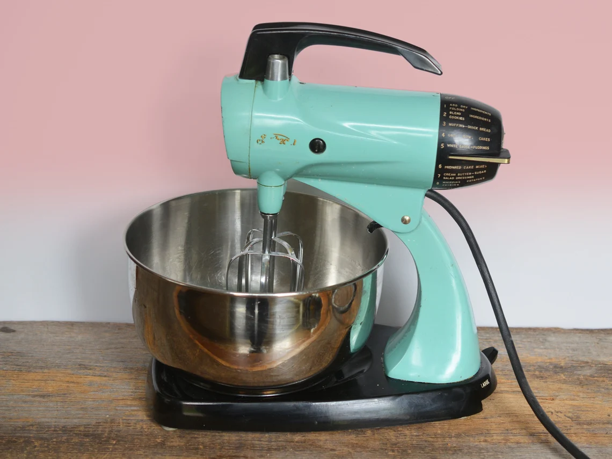
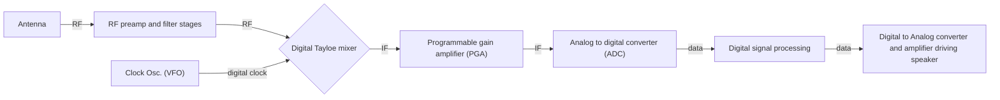
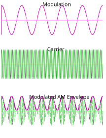

## What I'm Talking About
1. Software Defined Radio is everywhere.
2. How does SDR work?
3. A simplified example.
4. Demonstration.

---

## Software Defined Radio is everywhere.

content goes here

It has been everywhere for a while now.

--

## Your radios: ham, car, handheld, phone, baby monitor

content goes here

--

## Why so popular?

## Typical Superheterodyne Receiver{data-auto-animate="true"}

:::{.r-stack}

[RF preamplifier and filter stages amplify and select the desired
signals or range of signals. ]{data-highlight-node="in"}

[Mixer(s) to convert input signal frequencies up or down into IF
range.]{data-highlight-node="mix"}

["Intermediate Frequency" (IF) amplifier and filter stages amplify
and further narrow frequency selection. ]{data-highlight-node="if"}

[The demodulator (also called a "detector" in antiquity) takes a
selected IF signal and turns it into audio. ]{data-highlight-node="demod"}

[Audio output and filter stages further amplify the signal and choose
what to let through (mostly for CW) to speaker or headphones.
]{data-highlight-node="audio"}

:::

## Intermediate Frequency (IF)

:::: {.columns style="display: flex; align-items: center; gap: 2rem;"}

::: {.column width="75%"}
* Our desired signal frequency is $F$ MHz.
* Let $I$ be our "intermediate frequency" which actually passes some
  half-bandwidth $B$ range of frequencies: $I \pm B$.
* We want our signal to show up in middle of IF at $I$.
* It's much easier to amplify and provide selectivity if we put
  desired signals in low, fixed frequency range.
:::

::: {.column width="25%"}

:::
::::

## Mixers to map to IF

:::: {.columns style="display: flex; align-items: center; gap: 2rem;"}

::: {.column width="75%"}

* Take a range of signals in range $F \pm B$ and convert them to the range $I \pm B$.
* Frequency $F$ is mapped into the IF bandwidth.

:::

::: {.column width="25%"}

:::
::::

## Mixer details
* Mixers produce both [$F + F_{LO}$]{.high-freq} and [$F - F_{LO}$]{.low-freq} on their output.
* We want mixer to take $F$ and put it at $\frac{80kHz}{2} = 40kHz$.
* Our "local oscillator" needs to generate $F_{LO} = F + 40kHz$ so the mixer puts $F$ at [$F - F_{LO}$]{.low-freq}.
* We'll just ignore the "high side" output [$F + F_{LO}$]{.high-freq} (which is at $2 \times F + 80kHz$).
* We'll use the signal [$F - F_{LO}$]{.low-freq}.
* $F$ is mixed down to sit at exactly $-40kHz$.
* (Yes negative frequency is a thing in SDR.)

## Typical SDR Receiver{data-auto-animate="true"}

:::{.r-stack}

[RF preamplifier and filter stages amplify and select the desired
signals or range of signals. ]{data-highlight-node="in"}

[Clock oscillator serves as VFO, but it's fully digitally synthesized
based on a fixed frequency like 40MHz, dividing and multiplying to
give the precise frequency to add/subtract from the incoming signal in
the digital mixer.]{data-highlight-node="clk"}

[Digital mixer to convert RF to "baseband" -- which is the SDR
equivalent of the IF. This is a type of "product detector" which may
be a familiar term. It was invented by Dan Tayloe (N7VE) while working
at Motorola in 2001 -- U.S. Patent No.
6,230,000.]{data-highlight-node="mix"}

[Programmable gain amplifier allows DSP math to choose the range of
numbers representing the digital version of the signal to make it fit
in ADC's allowed dynamic range. This choice is part of how Automatic
Gain Control (AGC) works in SDRs.]{data-highlight-node="pga"}

[The Analog to Digital Converter (ADC) takes us out of the icky analog
domain in the world of pure, clean, mathematically perfect numbers. At
least in theory.]{data-highlight-node="adc"}

[The Digital Signal Processing (DSP) is all math. It works by applying
identical calculations repetitively to the incoming stream of numbers
(called "samples"), to produce another stream of numbers. More on this
next in slide.]{data-highlight-node="math"}

[Convert the digital numbers back to analog for human ears. In our
simplest SDR this is a PC sound card's output
path.]{data-highlight-node="dac"}

:::

## More DSP details

:::{.r-stack}

[Filters can easily be done in the digital world, and nearly
perfectly.]{data-highlight-node="filter1"}

[Demodulation is where much of the magic lives. In the digital world,
this is done by math specific to the type of signal we're listening
to. There's one type for upper or lower sideband (which are nearly
identical), another for AM, another for FM, more for FT4/FT8, WSPR,
and myriad others. CW is handled by the upper sideband
demodulator.]{data-highlight-node="demod"}

[More DSP math to do filtering after demodulation. This provides CW
narrowband, etc.]{data-highlight-node="filter2"}

:::

## Simplest SDR
* The "Simplest SDR" is a demonstration board comprised of only three
  relatively low tech chips doing simple things.
* The first is the clock generator, which is helped by an external
  frequency synthesizer instrument.
* Next comes the Tayloe digital mixer.
* Last is a dual amplifier to take the signals from the Tayloe and do
  analog math on them (yes we still can use analog math) to generate
  our output I and Q samples.

## What are I and Q samples?

* I = "In phase"
* Q = "Quadrature"
* These allow not only the instantaneous voltage but also the phase of
  the signal to be conveniently captured as a complex number.
  * Some might see this use of complex number math as inconvenient,
    but, believe me, it simplifies things.

## Why pick 40kHz for our $F_{LO}$ offset from $F$?
* Suppose our IF bandwidth $B$ were larger -- like, say, 300kHz.
* We could then see most of an HF ham band within the IF at once!
* We can tune which signal we want out of the IF
  * By choosing what frequency we demodulate from the IF.

## So what?

* In Simplest SDR, we deliberately mix our signal to place it inside
  an IF baseband instead of directly producing audio (more on this
  last technique later).
* This allows us to tune around within a range of frequencies
  *without* changing the clock oscillator (VFO) frequency.
* It also allows us to demodulate numerous signals at once
  * To show a waterfall.
  * To decode many signals simultaneously like CW or RTTY or FT8.
  * TO choose -- even automagically! -- different demodulator math
    types depending on the type of signals we see.

## How is demodulation done? (AM example)

* Imagine a crystal radio.
* It has a tuned circuit to select a station.
* From this it passes the signal through a diode, and then pretty much
  directly to the headphones.
* How can this work?

## AM Signal

:::: {.columns}

::: {.column width="50%"}

* **Modulation**: voice or music or FT8 or whatever.
* **Carrier**: transmit frequency.
* **Envelope**: (Created using an analog mixer or digital Tayloe mixer.)

:::

::: {.column width="50%"}

:::
::::

## How to demodulate this AM?

:::: {.columns}

::: {.column width="55%"}

* A crystal radio uses a diode to chop off bottom half of carrier envelope.
* In SDR we just zero all samples that are < 0.
* We slide result down to center it around zero volts again with an AC
  coupling capacitor in crystal radio or simple subtraction in SDR.
* Then a low pass filter is used to clean off the carrier.
* *Et voilá* -- we have audio.

:::

::: {.column width="45%"}

:::
::::

## Why such a small IF bandwidth?
* BTW: IF bandwidth $B$ for our SDR is constrained by PC's audio sample rate: 96kHz.
  * We avoid problems crappy audio card problems by choosing to use $B = 80kHz$.
* The IF bandwidth is limited by our analog to digital converter.
  * In this case, a cheap PC sound card with 96k samples/sec.
  * BTW we can buy ADCs to sample at 1M samples/sec pretty cheaply.

## Generating audio directly from digital mixing
* FYI Some cheap direct conversion receivers use $I$ = 0Hz$.
  * I.e., Their VFO frequency is their local oscillator frequency.
  * $F - F_{LO} = 0Hz$.
* This derives audio from AM signals by literally mapping the signal's
  carrier to 0Hz.
* We want to avoid this, for *reasons*.

## A simplified example.

## Demonstration.
